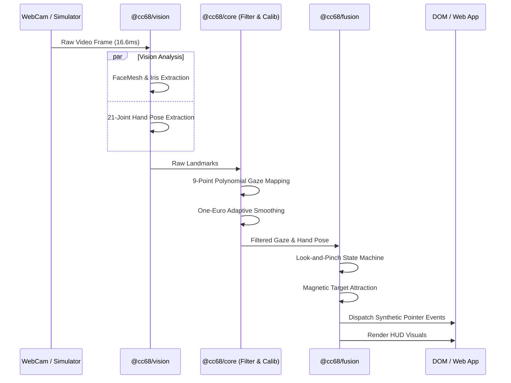

# EyeHand (cc68) — System Architecture

## 1. Architectural Layers

The architecture of EyeHand is divided into four distinct, loosely coupled layers structured as a pnpm monorepo:

```
┌────────────────────────────────────────────────────────┐
│                      apps/web                          │
│   (Vite + React 18 + Tailwind + Spatial HUD Canvas)    │
└───────────────────────────▲────────────────────────────┘
                            │
┌───────────────────────────┴────────────────────────────┐
│                   @cc68/fusion                         │
│  (Look-and-Pinch Machine, Magnetic Snapping, Events)   │
└─────────────▲────────────────────────────▲─────────────┘
              │                            │
┌─────────────┴─────────────┐┌─────────────┴─────────────┐
│       @cc68/vision        ││        @cc68/core         │
│ (MediaPipe Pipeline,      ││ (Vector Math, 1€ Filter,  │
│  Camera Stream, Mocking)  ││  Calibration, Event Bus)  │
└───────────────────────────┘└───────────────────────────┘
```

---

## 2. Package Responsibilities

### `@cc68/core`
* **Zero Dependencies**: Pure TypeScript mathematical and data model library.
* **Vector Mathematics**: 2D and 3D vectors (`Vector2`, `Vector3`), Euclidean distances, dot/cross products, normalization, and linear interpolation (`lerp`).
* **Coordinate Transformations**: Mapping between camera pixel space, Normalized Device Coordinates (NDC $[0, 1]$), and viewport screen space.
* **1€ (One-Euro) Filter**: Casiez et al. CHI 2012 velocity-adaptive low-pass filtering. Smooths out ocular tremor and hand jitter while maintaining low-latency response during fast movement.
* **Event Bus**: Type-safe event dispatch engine for decoupling vision producers from UI consumers.

### `@cc68/vision`
* **MediaStream Management**: Native browser `getUserMedia` acquisition, resolution negotiation, and frame timestamp synchronization.
* **MediaPipe Integration**:
  - `FaceLandmarker`: 478 points + iris center landmarks for gaze direction and Eye Aspect Ratio (EAR) blink calculation.
  - `HandLandmarker`: 21 3D joint landmarks per hand for gesture interpretation.
* **Synthetic Landmark Generator**: Headless, deterministic landmark replay system for automated testing and CI pipelines.

### `@cc68/fusion`
* **Look-and-Pinch State Machine**: Coordinates temporal sequence between gaze fixation and hand pinch gestures:
  - `Idle`: User is looking around; cursor follows gaze softly.
  - `Focus`: User fixates on an element for $>150\text{ms}$; element displays pre-hover highlight.
  - `PinchStart`: Index and thumb meet; `pointerdown` synthesized at target element.
  - `PinchDrag`: Hand moves while pinched; drag/scroll synthesized.
  - `PinchEnd`: Fingers separate; `pointerup` and `click` dispatched.
* **Magnetic Snapping**: Computes distance field to registered interactive DOM elements and applies non-linear attraction force to lock gaze jitter within target bounds.

### `apps/web`
* **Interactive HUD Canvas**: Visual rendering of iris landmarks, eye gaze crosshair, 21 hand joints, pinch progress ring, and real-time FPS/latency telemetry.
* **Interactive Spatial Playground**: Showcase containing touchless cards, virtual keypad, drag-and-drop objects, and freehand drawing canvas.

---

## 3. Data Flow Pipeline


