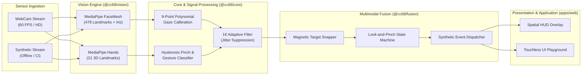

# EyeHand (cc68) — Project Overview

## 1. Executive Summary
**EyeHand (`cc68`)** is a next-generation, browser-native multimodal interaction system that unites real-time **Eye Gaze Tracking** and **3D Hand Gesture Estimation** into a seamless, touchless human-computer interface.

By decoupling **intentionality / target selection** (governed by where you look) from **action execution** (governed by micro-gestures like a thumb-index pinch), EyeHand implements the spatial computing "Look-and-Pinch" interaction paradigm directly inside standard web browsers without requiring specialized headsets, external hardware, or cloud servers.

---

## 2. Core Interaction Philosophy

### Solving the "Midas Touch" Problem
In traditional eye-tracking systems, looking at an interface element often causes unwanted clicks if the user lingers too long (dwell activation), or requires awkward exaggerated eye blinks. This is known in HCI as the **Midas Touch Problem**: everything you look at turns into an unintended action.

EyeHand solves this by assigning orthogonal roles to sensory channels:
1. **The Eye Acts as the Target Pointer**: The human visual system is extraordinarily fast at orienting attention. Where the eye fixates defines the active target bounding box.
2. **The Hand Acts as the Physical Trigger**: Micro-pinch gestures between the index finger and thumb provide the deliberate physical confirmation, drag control, or activation pulse.

---

## 3. High-Level System Architecture

---

## 4. Key Target Features

1. **Zero External Hardware**: Operates with any standard RGB webcam or built-in laptop camera.
2. **100% Client-Side Privacy**: Video streams never leave the user's browser; all inference is computed on-device via WebAssembly/WebGPU.
3. **Sub-15ms Processing Budget**: Designed to operate smoothly at 60 FPS on modern laptop hardware.
4. **Dynamic 1€ (One-Euro) Filtering**: Eliminates physiological micro-saccade tremor at rest while maintaining crisp, instantaneous tracking during rapid saccades.
5. **Magnetic Target Snapping**: Compensates for natural ocular drift by gravitationally snapping the selection point to nearby interactive UI elements.
